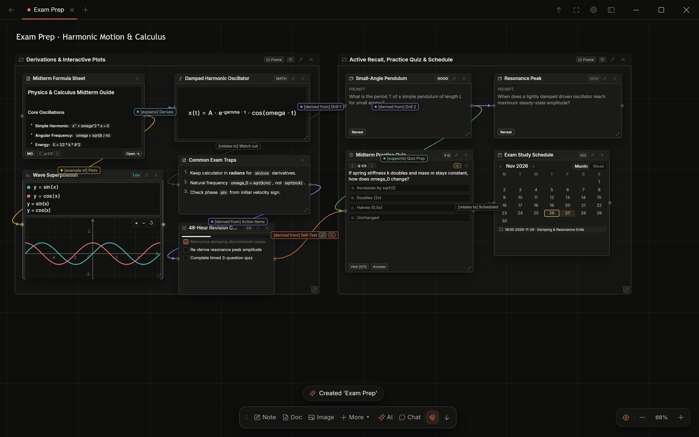
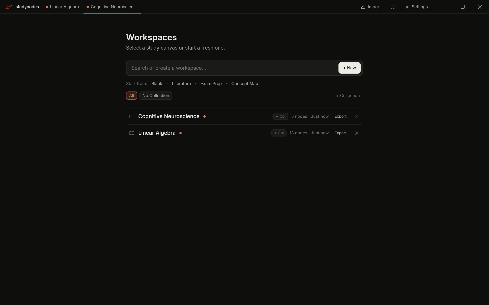
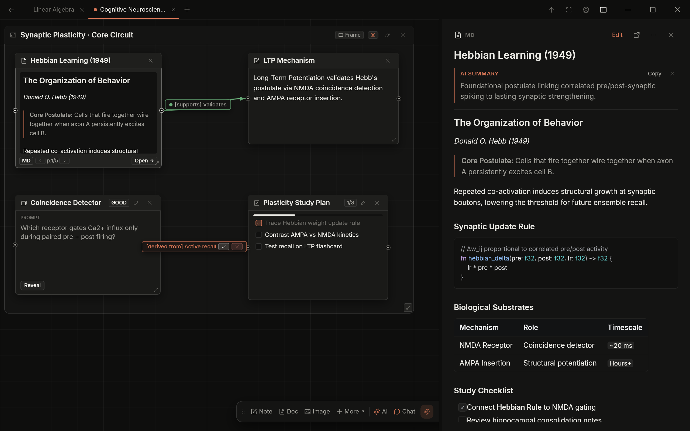
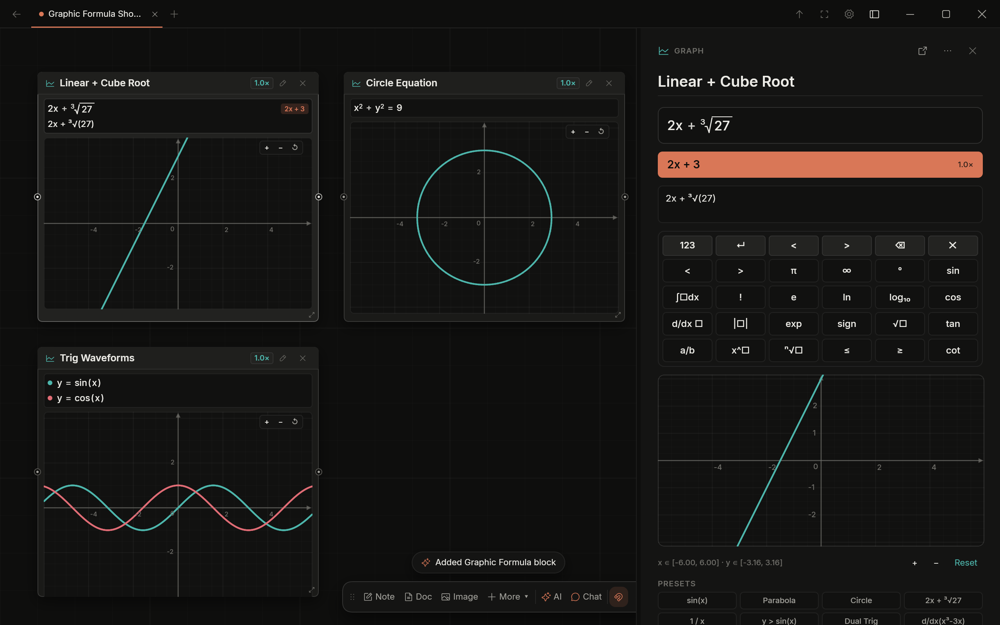
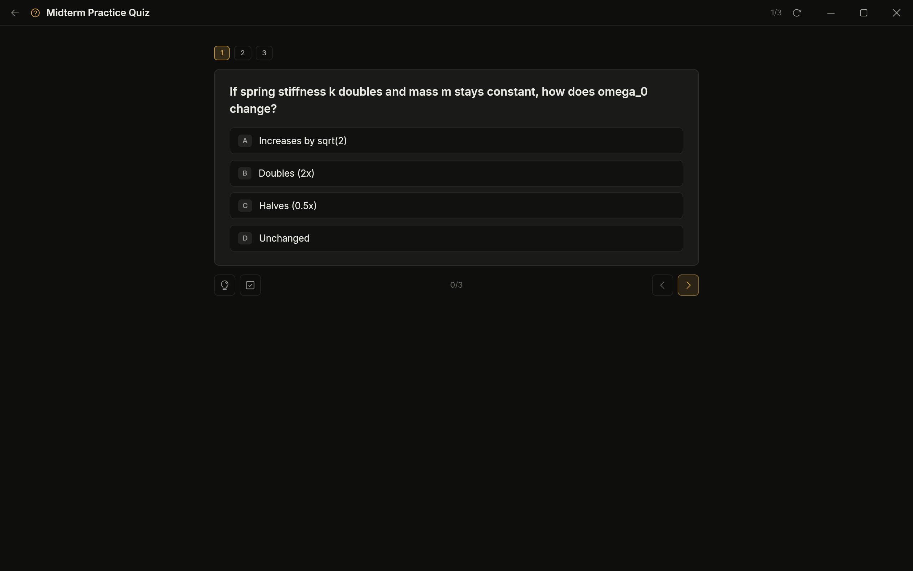
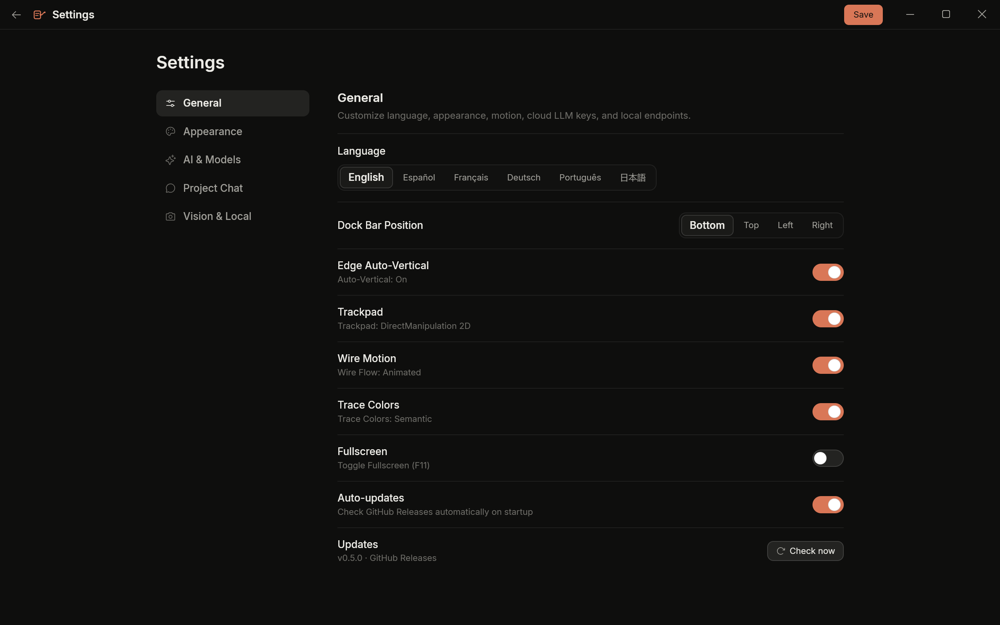

<div align="center">


# StudyNodes — Visual Knowledge Canvas

> A native GPU-accelerated desktop study environment built in **Rust** on the **Rune** UI runtime (`wgpu` / DirectX 12). StudyNodes combines an infinite spatial canvas, structured multi-format reading, live 2D mathematical typesetting and plotting, active recall quizzes, offline/cloud OCR, and human-in-the-loop LLM synthesis.



</div>

---

## Table of Contents

- [Core Features](#core-features)
  - [Dashboard, Multi-Project Tabs & Starter Templates](#dashboard-multi-project-tabs--starter-templates)
  - [Infinite Canvas, Framed Sections & Semantic Wires](#infinite-canvas-framed-sections--semantic-wires)
  - [18 Study Node Types](#18-study-node-types)
  - [2D Mathematical Equations & Interactive Graph Plotting](#2d-mathematical-equations--interactive-graph-plotting)
  - [Active Recall: Flashcards & Full-Screen Quizzes](#active-recall-flashcards--full-screen-quizzes)
  - [Multi-Format Document Reader, OCR & Translation](#multi-format-document-reader-ocr--translation)
  - [Media Playback, Calendar & Freehand Drawing](#media-playback-calendar--freehand-drawing)
  - [AI Canvas Synthesis & Project Chat](#ai-canvas-synthesis--project-chat)
  - [Settings, Themes, Localization & Auto-Updates](#settings-themes-localization--auto-updates)
- [Technical Architecture](#technical-architecture)
  - [Workspace Crates](#workspace-crates)
  - [Rendering & Performance Pipeline](#rendering--performance-pipeline)
  - [Graph Model, Patches & Undo History](#graph-model-patches--undo-history)
  - [Bundle Format & Atomic Persistence](#bundle-format--atomic-persistence)
  - [Formula Typesetter & Implicit Curve Plotter](#formula-typesetter--implicit-curve-plotter)
  - [OCR & Translation Pipeline](#ocr--translation-pipeline)
  - [Platform Integrations & Windows Installer](#platform-integrations--windows-installer)
- [Installation & Building from Source](#installation--building-from-source)

---

## Core Features

### Dashboard, Multi-Project Tabs & Starter Templates



- **Workspace Management**: Search existing `.studynodes` bundles, group projects into custom collections, rename or delete projects, and export/import `.studynodes` zip archives.
- **Multi-Project Tabs**: Keep multiple study projects open simultaneously in the top tab bar without losing camera position, selection, or draft edits.
- **Rich Starter Examples**: Launch immediately into pre-built **Literature**, **Exam Prep**, or **Concept Map** knowledge graphs showcasing framed sections, formulas, live plots, flashcards, quizzes, schedules, and semantic links—or start from a **Blank** canvas.

---

### Infinite Canvas, Framed Sections & Semantic Wires



- **Smooth Camera Navigation**: Pan with click-drag, middle-mouse, Space+drag, or native 2D Windows Precision Touchpad gestures; zoom smoothly anchored to the cursor.
- **Framed Sections**: Organize related cards inside labeled, color-tinted group frames (`Section` nodes). Dragging a section moves all contained cards together; sections can also pop out into a dedicated window or export to a high-DPI PNG screenshot.
- **Typed Cubic Bézier Wires**: Connect any node's output socket to another node's input socket with directional arrowheads, midpoint relation badges (`supports`, `contradicts`, `derived_from`, `explains`, `example_of`, `relates_to`, or custom labels), per-trace semantic colors, and animated GPU flow pulses.
- **Movable Dock**: Anchor the floating creation dock to the bottom, top, left, or right edge—or drag it freely into vertical icon-only mode.

---

### 18 Study Node Types

| Node Kind | Purpose | Key Capabilities |
| --- | --- | --- |
| **Note** | Markdown study card | Headings, lists, tables, code blocks, inline editing & scrolling |
| **Document** | File & syllabus reader | PDF, DOCX, ODT, PPTX, XLSX, EPUB, HTML, RTF, CSV, TXT, MD |
| **Image** | Visual diagrams & figures | Frameless or framed mode, resizing, OCR & translation extraction |
| **Text** | Floating canvas headings | Borderless typography with Sans/Serif/Mono/Display/Hand styles |
| **Formula** | 2D mathematical expressions | Multi-page math keyboard (`123`/`f(x)`/`abc`/`αβγ`), fraction/root/integral layout & instant evaluation |
| **Graph Formula** | 2D plot & implicit solver | Plots `y = f(x)`, multi-curve expressions, implicit `f(x, y) = g(x, y)` curves, and inequalities |
| **Flashcard** | Spaced recall card | Front/back flip view with mastery ratings (`new`, `again`, `good`, `easy`) |
| **Quiz** | Multi-question practice deck | Inline or full-screen Popout overlay, **Easy** (pause/resume) & **Hard** (locked until finished/give up) modes, hints, and question/answer images |
| **Sequence** | Ordered causal/procedural steps | Step badges (`Step 1`, `Step 2`, ...) and chained step spawning |
| **Checklist** | Interactive task card | Clickable Markdown `- [ ]` / `- [x]` items directly on the canvas |
| **Excerpt** | Source quotation card | Deep-linked back to exact source `Document` node and page |
| **Concept** | Core topic anchor | Topic hub for concept maps and semantic clusters |
| **AI Synthesis** | LLM-generated summary | Cross-node synthesis generated from selected neighborhoods |
| **Section** | Spatial group container | Framed area or banner with group drag, pop-out, and PNG export |
| **Calendar** | Study schedule & planner | Month and 7-day Week views, timed events, day notes, linked cards |
| **Video** | Video study card | Local MP4/WEBM playback or WebView2 embeds (YouTube, Vimeo) with timestamp jumps |
| **Audio** | Audio & subtitle card | Local/stream playback, `.srt`/`.vtt` parsing, auto-transcription & timestamps |
| **Drawing** | Freehand sketch canvas | Multi-color vector strokes, eraser, and OCR/formula recognition |

---

### 2D Mathematical Equations & Interactive Graph Plotting



- **Structured 2D Typesetting**: Expressions such as fractions (`(a+b)/c`), nth roots (`root(n, x)` / `√x`), exponents, subscripts, summations, integrals, logarithms, and Greek symbols render as true stacked 2D math in both canvas cards and the inspector.
- **Multi-Page Keypad**: Switch cleanly between numbers/operators (`123`), calculus/trig/logic functions (`f(x)`), Latin letters (`abc`), and Greek symbols (`αβγ`), or toggle raw LaTeX/ASCII input (`\alpha`, `\frac{a}{b}`, `\sqrt{x}`).
- **Live Symbolic Readout**: Automatically evaluates arithmetic and simplifies linear/algebraic expressions (e.g., `2x + root(3, 27) -> 2x + 3`) in a highlighted result banner.
- **Interactive Plotter**: Supports explicit `y = f(x)`, multiple stacked functions, implicit equations (circles, conics via marching squares), and inequalities with mouse-wheel zoom and pan inside every `Graph Formula` card.

---

### Active Recall: Flashcards & Full-Screen Quizzes



- **Inline or Full-Screen Popout Quiz**: Run quizzes directly inside a canvas node (`Regular`) or launch a distraction-free full-screen overlay (`Popout`).
- **Two Difficulty Modes**:
  - **Easy**: Pause at any question, return to the canvas scheme to check notes, and resume from where you left off, or reset to retry.
  - **Hard**: Locks navigation back to the canvas until the quiz is completed or you explicitly press **Give Up** (marking the attempt failed until retried).
- **Rich Question Decks**: Supports multiple-choice or free-response prompts, progressive hints, detailed answer explanations, and attached images on both questions and answers.

---

### Multi-Format Document Reader, OCR & Translation

- **Built-in Reader Panel**: Clicking a `Document` node opens its formatted preview in the docked side panel (read-only mode or full edit mode) with Continuous, Two-Page, and Single-Page PDF layouts powered by `hayro`.
- **Supported Formats**: PDF, DOCX, ODT, PPTX, XLSX, EPUB, HTML, RTF, CSV, Markdown, plaintext, and images—each imported via content-addressed SHA-256 hashing into the bundle's `assets/` directory.
- **OCR & Translation**: Run local offline OCR (`PP-OCRv5` ONNX models) or Cloud Vision APIs (Gemini Vision, OpenAI-compatible vision endpoints) on `Image` and `Drawing` nodes, and translate cards via local Ollama or configured cloud APIs across 6 languages.

---

### Media Playback, Calendar & Freehand Drawing

- **Video & Audio Nodes**: Play local media files natively or stream YouTube, Vimeo, and Spotify embeds inside WebView2 with interactive timestamp bookmarks and synchronized `.srt`/`.vtt` subtitles.
- **Calendar Planner**: Track deadlines in Month or 7-day Week view, attach notes per day, link calendar events to canvas nodes, and schedule sessions directly through AI Chat.
- **Drawing Pad**: Sketch diagrams or handwritten derivations directly on canvas cards with selectable ink colors and stroke widths.

---

### AI Canvas Synthesis & Project Chat

- **Neighborhood Synthesis**: Select any cluster of nodes and trigger AI analysis to generate summaries, synthesis nodes, or **Proposed ("ghost") Edges** rendered in accent purple with one-click Accept (`✓`) / Dismiss (`×`) controls.
- **Project AI Chat**: Discuss the whole graph or specific topics in per-project multi-tab conversations with optional **Canvas Actions**, allowing the assistant to create, move, connect, arrange sections, populate calendars, build quizzes, and ingest web image search results directly with full undo/redo support.
- **Flexible Providers**: Works with Gemini, OpenAI, Anthropic, OpenRouter, Groq, DeepSeek, or local Ollama servers (auto-routed by key prefix or custom Base URL).

---

### Settings, Themes, Localization & Auto-Updates



- **Organized Sidebar Settings**: Separated into **General**, **Appearance**, **AI & Models**, **Project Chat**, and **Vision & Local** tabs with sliding toggle switches and unified segmented controls.
- **6 Built-in Themes**: Warm Charcoal (default), Dark, Light, Tokyo Night, Solarized Dark, and Solarized Light.
- **6 UI Languages**: English, Español, Français, Deutsch, Português, and 日本語.
- **Automatic Updating**: Checks GitHub Releases (`inziz/studynode`) on startup (toggleable) and performs an atomic self-update + restart with PE header validation and rollback protection.

---

## Technical Architecture

### Workspace Crates

| Crate | Role |
| --- | --- |
| `crates/studynodes-graph` | UI-agnostic graph core: `Node`, `Edge`, `Camera`, `CubicBezier`, spatial indices, `GraphPatch` diff engine, `CommandHistory` undo/redo, and atomic `.studynodes` bundle I/O |
| `crates/studynodes-llm` | Context neighborhood serializer, `GraphPatch` / chat action prompt engineering & forgiving JSON extraction, plus Gemini / OpenAI-compatible / Anthropic / Mock clients |
| `crates/studynodes-vision` | Local `PP-OCRv5` ONNX pipeline (`oar-ocr`), Cloud Vision clients, image pre-processing, and multi-backend text translation (`Ollama`, Gemini, MyMemory) |
| `crates/studynodes-app` | Native Rune desktop application: canvas renderer, document/PDF reader, math AST/plotter, quiz/calendar/media/drawing views, DirectManipulation touchpad handler, WebView2 host, and auto-updater |
| `crates/studynodes-installer` | Self-contained per-user Windows setup & uninstaller (`studynodes-setup`) |

### Rendering & Performance Pipeline

StudyNodes is engineered for fluid interaction and near-zero idle overhead even across multi-hour sessions:

- **Zero-Rebuild Pan, Zoom & Wire Motion**: Camera pan (`live_offset`), pinch/wheel zoom (`live_scale`), and animated wire pulses (`live_trim`) drive GPU uniforms via Rune `Live` bindings (`tx.live_only()`, returning `false` from `spec.poll`) with no view tree reconstruction or Taffy relayouts mid-animation.
- **Idle Auto-Sleep (`window::rest`)**: After 30 seconds without pointer, wheel, touchpad, or keyboard activity, periodic wire animation wakes stop completely, allowing Rune to enter `window::rest`, drop CPU/GPU wakeups to 0%, and reclaim transient GPU layer targets and upload staging buffers.
- **Subtree Memoization & Frustum Culling**: Viewport culling (`CULL_MARGIN`) skips offscreen cards, zoom level-of-detail switches dense cards to lightweight title pills below `0.48x`, and heavy Note/Document Markdown and `GraphFormula` subtrees are wrapped in `rune::memo(...)` keyed by content hash, dimensions, zoom, and theme.
- **Bounded Memory Caches**: Image decodes (`decoded_images`), PDF page bitmaps (`pdf_page_cache` LRU), and document text previews (`doc_preview_cache`) enforce upper capacity bounds.

### Graph Model, Patches & Undo History

- **Coordinate Separation**: World positions (`WorldPos`) and screen positions (`ScreenPos`) convert cleanly via `Camera::world_to_screen` and `Camera::screen_to_world` with cursor-anchored logarithmic zooming (`zoom_at`).
- **Validated `GraphPatch` Staging**: LLM outputs and canvas actions apply through typed operations (`propose_connection`, `create_synthesis_node`, `create_study_node`, `move_node`, `arrange_nodes`, `update_quiz`, `calendar_*`, etc.) supporting temporary IDs (`tmp_*`) resolved before committing.
- **Snapshot & Command History**: Mutations record reversible state in `CommandHistory` so both manual edits and multi-node AI actions undo/redo cleanly (`Ctrl+Z` / `Ctrl+Y`).

### Bundle Format & Atomic Persistence

Projects are persisted by default in **`<Documents>\StudyNodes\`** (resolved via Windows `SHGetKnownFolderPath(&FOLDERID_Documents)` with automatic non-destructive migration from legacy `./study_projects` on first launch):

```text
<Documents>/StudyNodes/
├── reader_prefs.json              # Preferences, API keys, theme, locale, collections
└── MyTopic.studynodes/
    ├── project.json               # Graph topology, node metadata, chat threads, camera
    └── assets/                    # Content-addressed attachments (SHA-256)
```

Writes serialize in a background worker (`save_tx`), flush `project.json.tmp` to disk via `sync_all()`, and atomically rename to `project.json` while pruning orphaned assets.

### Formula Typesetter & Implicit Curve Plotter

1. **Tokenizer & Pratt/Recursive-Descent Parser** (`crates/studynodes-app/src/graph_formula.rs`): Parses ASCII math, Unicode operators (`√`, `³√`, `²`, `π`, `θ`, `×`, `÷`), implicit multiplication (`2x`, `(x+1)(x-1)`), and LaTeX shorthands into a structured AST.
2. **2D Layout Tree**: Recursively lays out stacked fractions with rule bars, dynamic radical glyphs with overbars for arbitrary nth roots, raised exponents, subscripts, and operator spacing directly inside Rune elements.
3. **Evaluator & Implicit Plotter**: Simplifies numeric/linear terms for live readouts, samples explicit functions across adaptive discontinuity breaks (`tan(x)`, `1/x`), and extracts implicit contour segments (`x² + y² = 9`, inequalities) via grid marching squares.

### OCR & Translation Pipeline

- **Offline Neural OCR**: Downloads/loads `PP-OCRv5` mobile detection + recognition ONNX models with image contrast normalization and upscaling for crisp screenshot text extraction.
- **Cloud Vision & Translation Fallback**: Supports structured text and formula extraction from Gemini Vision / OpenAI-compatible vision APIs, plus offline Ollama (`qwen2.5:3b` default) or cloud translation chunked cleanly along sentence boundaries.

### Platform Integrations & Windows Installer

- **Windows DirectManipulation Touchpad**: `crates/studynodes-app/src/touchpad_win32.rs` attaches a COM `IDirectManipulationViewport` restricted to the canvas bounds, enabling unlocked 2D diagonal panning and smooth pinch-zoom alongside standard mouse wheel fallback.
- **WebView2 Media Host**: `crates/studynodes-app/src/embed_webview.rs` runs an ephemeral `127.0.0.1` HTTP server that wraps YouTube, Vimeo, and Spotify iframes with valid origin/referer headers and tears down child WebViews whenever cards are hidden or deleted.
- **Auto-Updater**: `crates/studynodes-app/src/updater.rs` queries GitHub Releases, validates downloaded Windows PE (`MZ` header + size threshold), stages an atomic `<exe> -> <exe>.old -> <exe>.new` replacement with rollback on failure, relaunches, and cleans up `.old` on next boot.
- **Per-User Windows Installer**: `crates/studynodes-installer` embeds `studynodes.exe` and a `.ico` generated from `assets/logo.png`, installs to `%LocalAppData%\Programs\StudyNodes\` without UAC elevation, creates Start Menu and Desktop shortcuts (`IShellLinkW`), registers `HKCU\Software\Microsoft\Windows\CurrentVersion\Uninstall\StudyNodes`, and leaves `<Documents>\StudyNodes\` untouched on uninstall.

---

## Installation & Building from Source

### Windows Installer / Release Downloads

Download from [GitHub Releases](https://github.com/inziz/studynode/releases/latest):

- **`StudyNodes-Setup-v<version>-windows-x86_64.exe`** — Guided (or silent `/S`) per-user Windows installer with shortcuts and uninstaller registration.
- **`studynodes-v<version>-windows-x86_64.exe`** — Standalone portable executable (also used by the built-in auto-updater).

### Development Commands

```powershell
# Run the desktop application
cargo run -p studynodes-app

# Run all workspace unit, UI, and integration tests
cargo test --workspace --no-fail-fast

# Capture headless GPU UI screenshots from built-in showcase scenes
cargo run -p studynodes-app -- --snap docs/screenshots/exam-template.png --scene template_exam
# Available scenes: dashboard, workspace, settings, graph_formula, template_exam, quiz_popout

# Build release app + self-contained Windows setup executable
powershell -ExecutionPolicy Bypass -File scripts\build-installer.ps1
```
